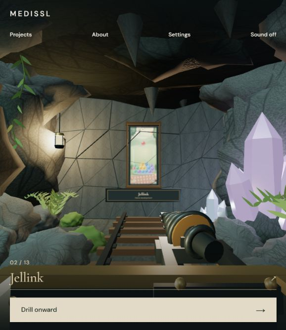
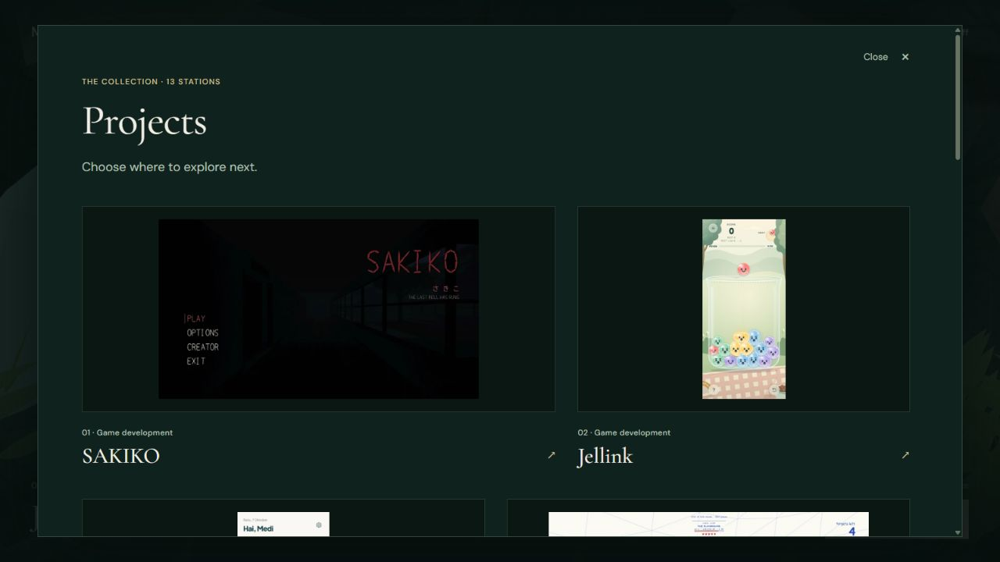
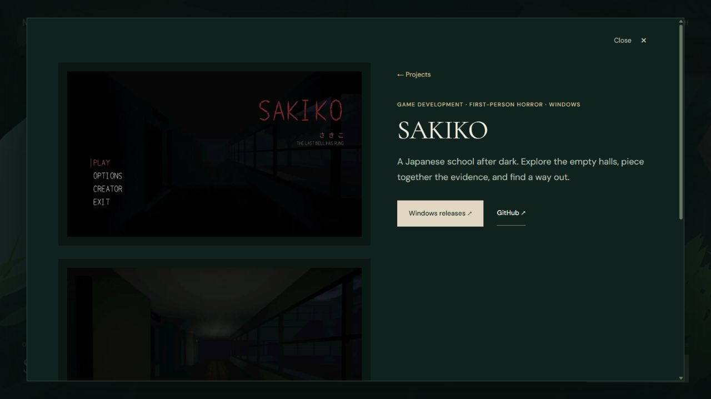
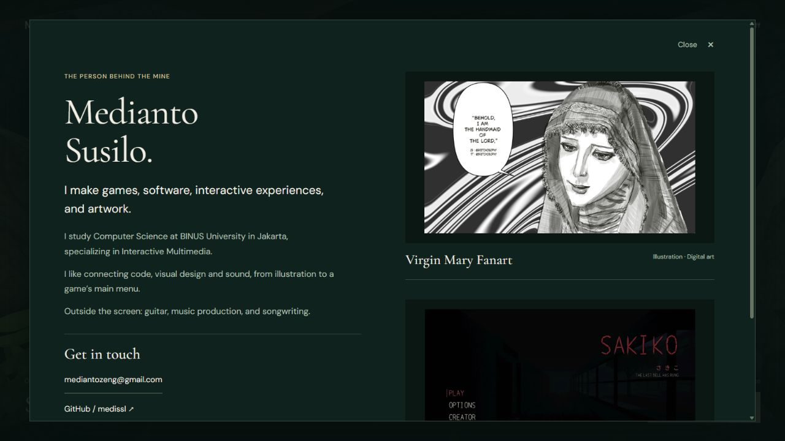
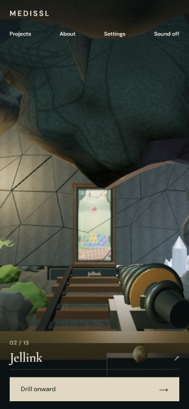

# MEDISSL · The Crystal Mine

An interactive portfolio by **Medianto Susilo**. Ride a drill minecart through a crystal cave, break through image-bearing stone walls, and discover games, software, and original artwork.

[Visit the portfolio](https://medissl-portfolio.vercel.app) · [Browse without 3D](https://medissl-portfolio.vercel.app/?view=projects) · [Audio credits](public/mine/audio/CREDITS.txt)



## Explore the work

The portfolio is both a small playable journey and a practical gallery. Choose any project directly, inspect its screenshots and process images, or keep drilling through the collection. The final station returns to the first.

| The collection | Project inspection |
| --- | --- |
|  |  |

- Textured cave formations, crystals, foliage, and atmospheric lighting built with Three.js.
- A working minecart and drill, progressive cracks, and shared image-and-stone fracture animation.
- Reusable chambers and walls: the world stays bounded as the collection grows.
- Direct station selection, shareable project links, galleries, and native browser Back/Forward.
- Responsive controls, keyboard navigation, reduced-motion travel, and a complete archive when WebGL is unavailable.
- Opt-in cave music and recorded mechanical, wheel, stone, and debris effects synchronized to animation frames.
- A private publishing dashboard backed by Supabase Auth, Postgres, Storage, and Row Level Security.

## A living CMS

Thirteen stations are the current collection, **not a fixed limit**. Ten curated repository projects are combined with published Supabase content. Publishing another project or artwork adds a discoverable station without changing code or rebuilding the cave.

The server reads published content on each request. An open mine refreshes every 60 seconds and on focus/visibility while idle. Titles, covers, galleries, order, station count, progression, and the return loop adapt to the current catalog. Refreshes preserve the selected project by ID; unpublishing an inspected item returns visitors to the current collection. Missing images receive a text presentation. Mewdi's pixel sprite is intentionally excluded without deleting its CMS record.

Studio at `/admin` supports drafts, publishing, cover/gallery/process uploads, featuring, and station ordering. CMS work follows the curated repository projects. Unsaved editor text and selected files persist in the browser. Database and storage writes require membership in `public.admin_users`; authenticating alone does not grant editing rights.

## Controls and accessibility

| Action | Control |
| --- | --- |
| Drill to the next station | **W**, **↑**, or **Drill onward** |
| Skip the current journey | **Escape** |
| Inspect a project | Project title, wall image, or **Projects** menu |
| Close a panel | **Escape** or **Close** |
| Visit any station | **Projects** → select work |
| Remove camera travel and destruction motion | **Settings → Instant travel**; system reduced-motion preference is respected |
| Enable music and effects | **Sound off** or **Settings → Enable sound** |
| Browse without WebGL | **Browse without 3D** |

Sound starts only after explicit interaction. Music and effects have separate sliders and saved preferences. Hidden tabs suspend audio; opening a panel stops mechanical effects. Decoded recordings loop with short crossfades, and a shared compressor provides mix headroom. A quiet, non-stacking navigation chime shares the Effects slider. Sound is optional: every action and project remains available silently.

The interface uses native dialogs, visible focus states, labeled controls, and live station announcements. Final listening quality and physical touch-device behavior require human review; signal measurements alone are not listening validation.

<details>
<summary>About and mobile views</summary>





</details>

## Technology

| Layer | Implementation |
| --- | --- |
| Application | Next.js **16.3.6**, App Router; React **19.2.8** |
| Language | TypeScript **6.0.3** |
| 3D | Three.js **0.186.1**, procedural geometry and mineral textures |
| Audio | Native Web Audio API, licensed recordings, decoded buffers and gain buses |
| Interface | Custom CSS with shared tokens; self-hosted Cormorant Garamond and DM Sans |
| Content and identity | Supabase JS **2.117.1**, Postgres, Auth, Storage, RLS |
| Hosting and checks | Existing Vercel project; GitHub Actions lint/build |

## Run locally

Use **Node.js 24** and npm. The lockfile is included.

```bash
npm ci
npm run dev
```

Open `http://localhost:3000`. Public browsing uses the existing browser-safe Supabase URL and publishable key as fallbacks. For your own Supabase project, copy `.env.example` to `.env.local` and provide:

```env
NEXT_PUBLIC_SUPABASE_URL=https://YOUR_PROJECT.supabase.co
NEXT_PUBLIC_SUPABASE_PUBLISHABLE_KEY=YOUR_PUBLISHABLE_KEY
```

Never place a secret or service-role key in a `NEXT_PUBLIC_*` variable. For another storage host, also update the image allowlist in `next.config.ts`.

For a separate database, review and apply the SQL files in [`supabase/migrations`](supabase/migrations) in order. Create the owner through the Supabase Auth dashboard, then add that user's UUID to `public.admin_users`. There is no public registration flow. Existing production infrastructure should not be recreated or reseeded.

```sql
insert into public.admin_users (user_id) values ('YOUR_AUTH_USER_UUID');
```

### Verify

```bash
npx tsc --noEmit
npm run lint
npm run build
```

Run each `docs/crystal-mine/*.test.mjs` file with Node. These cover journey progression, dynamic station mapping, navigation, fracture geometry, audio lifecycle, and the protected historical environment. For example:

```bash
node docs/crystal-mine/audio.test.mjs
node docs/crystal-mine/environment-baseline.test.mjs
```

The environment test requires the original Git checkpoints; use a full clone rather than a shallow source export. Direct TypeScript imports may emit Node's harmless typeless-package warning.

The [local CMS harness](docs/crystal-mine/cms-harness.cjs) and [Phase 5 verification notes](docs/crystal-mine/PHASE-5.md) describe isolated publishing tests. Its credentials and writes are test-only and must never be configured in a deployed build. The audio probe is injected only by that local harness, never by the application.

## Routes and source

`/` is the mine. `/mine`, `/work`, `/about`, `/contact`, and published `/work/[slug]` links lead into its matching views. `/?view=projects` is the lightweight archive. `/admin` and `/admin/projects` remain the private Studio.

```text
src/components/mine/   Three.js engine, journey, fracture, audio, catalog and interface
src/lib/               Supabase clients, published catalog loader, editor utilities
src/app/api/mine/      Uncached catalog refresh endpoint
src/app/admin/         Authenticated Studio
public/mine/           Project media and licensed audio
supabase/migrations/   Schema, storage and RLS history
docs/crystal-mine/     Verification, protected-baseline checks and real screenshots
```

## Credits

- Cave music: **beardalaxy**, *Mysterious Cave Theme Loop* — CC0.
- Cordless-drill recording: **dklon**, *Drill 1* — **CC BY 3.0**.
- Masonry-drilling recording: **marvman**, *drilling.wav* — CC0.
- **Sound Effect By Nicole Marie T**: *Office Chair Roll Sfx Sound Effect* — **CC BY 4.0**, adapted for wheel playback.
- Rock destruction: **Bertsz**, *Rock destroy* — CC0.
- Navigation chime: **Kenney**, *Impact Sounds 1.0* — CC0.

Source links, licenses and modifications are documented in [audio/CREDITS.txt](public/mine/audio/CREDITS.txt), also available from the site's Settings. Font licenses accompany the files in [`public/fonts`](public/fonts). Portfolio project images and artwork belong to their respective projects and creators; this repository does not grant a blanket license to reuse them.

All screenshots above were captured from the actual optimized application, not generated mockups. The existing production address is [medissl-portfolio.vercel.app](https://medissl-portfolio.vercel.app); release status and human review gates are tracked in the release notes.
